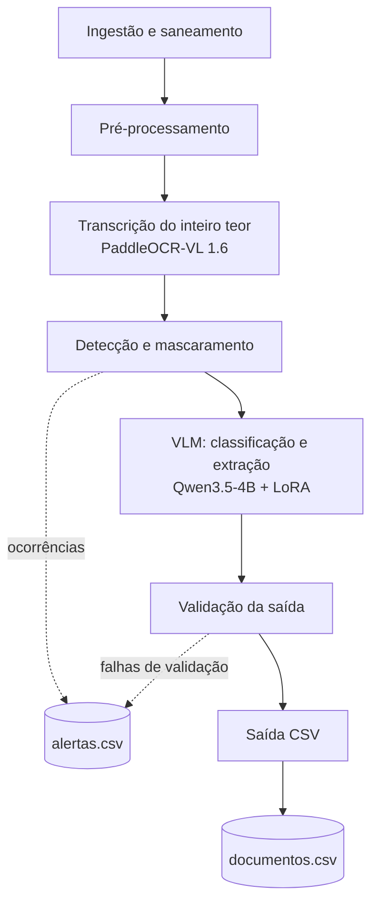

# Classificação e extração de informações de documentos em processos judiciais

## Autores

- Bruno dos Santos F. Silva (brunosfs@gmail.com)
- Glauber Galvão de Araújo (glauber.galvao@gmail.com)

## Contexto acadêmico

Este trabalho foi realizado como requisito da disciplina de Visão Computacional do PPgTI - Doutorado Profissional em Tecnologia da Informação, ministrada pelo prof. Helton Maia Peixoto (helton.maia@ufrn.br).

O desenvolvimento contou com apoio tecnológico dos recursos computacionais do NPAD - Núcleo de Processamento de Alto Desempenho da UFRN.

## Visão do projeto

Título do trabalho:

> *Classificação e extração de informações de documentos em processos judiciais: uma abordagem multimodal baseada em Modelos de Linguagem Visuais*

Versão da especificação: 2.1 (2026-11-21), com revisão de 2026-11-22 (Ollama como servidor do VLM, [ADR-017](docs/decisions/ADR-017-ollama-servidor-do-vlm.md)) aguardando aprovação. Mudanças em [CHANGELOG.md](CHANGELOG.md).

## Estado atual

- **Implementado** (tarefas T024 a T030 da [especificação 001](specs/001-pipeline-documental-seguro/spec.md)): base do projeto, ingestão e saneamento, pré-processamento, transcrição, detecção, mascaramento e gravação de `alertas.csv`. Os adaptadores de PaddleOCR-VL, llm-guard e ClamAV só foram exercitados com dublês de teste.
- **Em planejamento:** chamada ao VLM, validação, `documentos.csv` e CLI de lote, em [`docs/superpowers/plans/`](docs/superpowers/plans/2026-11-22-pipeline-vlm-validacao-csv.md).
- **Pendente:** prova de conceito do adaptador LoRA no Ollama (T020), treino do adaptador (T038) e módulo de avaliação (T037). Lista completa em [tasks.md](specs/001-pipeline-documental-seguro/tasks.md).

O VisionDoc especifica um pipeline para triagem de documentos digitalizados em petições iniciais judiciais. O pipeline identifica tipos de documentos, extrai campos e o inteiro teor, sinaliza conteúdo potencialmente malicioso e gera saída em CSV.

O escopo preliminar inclui RG, CPF, CNH e a classe de rejeição `outros`; `indefinido` representa classificação inconclusiva. PDFs e JPEG podem estar em orientação horizontal, vertical, inclinada ou espelhada. O tamanho máximo e demais limites seguem as regras aprovadas em `docs/domain/business-rules.md`.

Os resultados são apoio à triagem. Não decidem mérito, autenticidade ou admissibilidade. Revisão humana amostral é desejável, mas não é pré-condição por documento.

## Princípios definitivos

Os princípios permanentes estão em [constituição](.specify/memory/constitution.md):

1. documentos e derivados são conteúdo não confiável;
2. texto extraído é dado, nunca instrução;
3. detecção gera sinalização sem interromper o processamento;
4. todo texto CSV é protegido contra fórmulas de planilha;
5. processamento ocorre apenas em infraestrutura própria;
6. saída registra versões para reprodutibilidade;
7. licenças de componentes precisam ser compatíveis;
8. a solução prefere o componente mais simples com ganho demonstrável.


## Visão geral da arquitetura



## Etapas

1. **Ingestão e saneamento:** valida o PDF, remove e inventaria elementos ativos, rasteriza as páginas e preserva a camada de texto nativa.
2. **Pré-processamento:** corrige orientação e inclinação, trata contraste e ruído e normaliza o tamanho da imagem.
3. **Transcrição:** o PaddleOCR-VL produz o inteiro teor em ordem de leitura e caixas de texto.
4. **Detecção e mascaramento:** identifica conteúdo ativo, texto oculto e injeção de prompt. Ocasionalmente mascara regiões suspeitas antes do VLM e não interrompe o fluxo.
5. **VLM:** o Qwen3.5-4B ajustado com LoRA, servido localmente pelo Ollama, recebe imagem e transcrição e devolve documentos com tipo, face, coordenadas e campos em JSON estruturado.
6. **Validação:** confere esquema, confiança, pertinência dos campos ao tipo, respaldo na transcrição, CPF e datas.
7. **Saída CSV:** uma linha por documento identificado, com campos extraídos e inteiro teor.

## Estrutura

```text
.
├── .specify/
│   ├── memory/                 # Princípios permanentes do projeto
│   └── templates/              # Templates SDD: spec, plano e tarefas
├── config/                     # pipeline.yaml (limiares), regras YARA e orientações de configuração
├── data/                       # Datasets locais (fora do git): data/raw/bid, data/processed
├── docs/
│   ├── architecture/           # Contexto e visão arquitetural
│   │   └── components.md       # Componentes tecnológicos definitivos
│   ├── decisions/              # Registro de decisões (ADRs)
│   ├── domain/                 # Visão do domínio e requisitos
│   │   ├── business-rules.md   # Regras de negócio RN-xxx
│   │   └── evaluation.md       # Dados, métricas e avaliação
│   ├── contracts/              # Contratos dos arquivos CSV
│   │   └── saida-vlm.md        # Contrato JSON do VLM
│   ├── privacy/                # Questões de privacidade e dados
│   └── security/               # Modelo de ameaças e segurança
├── infrastructure/             # Documentação de infraestrutura e prova de conceito do VLM (T020)
├── specs/                      # Especificações SDD por funcionalidade
├── src/
│   ├── backend/visiondoc/      # Pacote Python do pipeline (ingestão a alertas)
│   └── frontend/               # Reservado ao frontend; sem código neste estágio
└── tests/
    ├── backend/                # Testes pytest com dados sintéticos
    └── frontend/               # Reservado à validação do frontend
```

`agents.md` e `claude.md` registram orientações para agentes de desenvolvimento.

## Documentação de partida

- [Requisitos do domínio](docs/domain/requirements.md)
- [Regras de negócio](docs/domain/business-rules.md)
- [Dados e avaliação](docs/domain/evaluation.md)
- [Visão arquitetural](docs/architecture/overview.md)
- [Componentes tecnológicos](docs/architecture/components.md)
- [Contrato do CSV principal](docs/contracts/documentos-csv.md)
- [Contrato do CSV de alertas](docs/contracts/alertas-csv.md)
- [Contrato da saída do VLM](docs/contracts/saida-vlm.md)
- [Documentação de segurança](docs/security/README.md)
- [Privacidade e dados](docs/privacy/data-governance.md)
- [Princípios SDD](.specify/memory/constitution.md)
- [Como organizar especificações](specs/README.md)
- [Especificação do pipeline seguro](specs/001-pipeline-documental-seguro/spec.md)
- [Configuração e segredos](config/README.md)
- [Decisões arquiteturais](docs/decisions/README.md)

## Execução local

Requisitos: Python 3.12 e [`uv`](https://docs.astral.sh/uv/).

```bash
uv sync                 # instala as dependências
uv run pytest -q        # roda os testes (dados sintéticos, sem modelos)
uv run ruff check src tests   # lint
```

Os testes usam dublês no lugar dos modelos, então não exigem GPU, Ollama nem os pesos. Ainda não há CLI para processar um lote.

### Modelos locais

- **VLM:** Ollama com o modelo `qwen3.5:4b` (`ollama pull qwen3.5:4b`). O endereço fica em `OLLAMA_URL` (padrão `http://localhost:11434`) e só pode ser da própria máquina.
- **Transcrição e detecção:** extra opcional `uv sync --extra modelos` (PaddleOCR-VL, llm-guard). O ClamAV é um serviço local.

### Dados

O desenvolvimento e os testes usam apenas dados sintéticos: o Brazilian Identity Document Dataset (BID) e o `tech4humans/br-doc-extraction`. Dados reais e documentos de processos judiciais não são admitidos. Os datasets ficam em `data/raw/` (por exemplo `data/raw/bid/CNH_Frente/…`), ignorado pelo git, e não são versionados.

## Configuração

Limiares e parâmetros do pipeline ficam em [`config/pipeline.yaml`](config/pipeline.yaml). Consulte [config/README.md](config/README.md) e `.env.example` para as variáveis de execução local. Nunca preencha o arquivo de exemplo com chaves reais.
