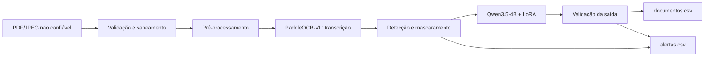

# Arquitetura lógica da solução

Versão 2.0 (2026-11-20).

## Fluxo lógico

## Responsabilidades

1. Ingestão valida o arquivo, calcula SHA-256, remove conteúdo ativo e rasteriza o PDF.
2. Pré-processamento corrige orientação, inclinação e qualidade.
3. PaddleOCR-VL gera inteiro teor em ordem de leitura e caixas.
4. Detecção correlaciona conteúdo ativo, texto oculto e injeção. Ocorrências são registradas sem interromper.
5. Regiões suspeitas são mascaradas na imagem e substituídas na transcrição enviada ao VLM.
6. Qwen3.5-4B identifica documentos, localização, tipo, face e campos em JSON restrito.
7. A saída é validada contra esquema, confiança, tipo, transcrição e consistência.
8. A saída principal e os alertas são escritos em CSV seguro.

## Invariantes

- Documentos e derivados são conteúdo não confiável.
- Texto nunca é instrução para modelo generativo.
- Detecção não bloqueia nem desvia o documento.
- Falha de gravação de alerta não bloqueia o documento.
- Todo campo CSV é protegido contra fórmulas.
- Processamento ocorre em infraestrutura própria.
- Campos não respaldados são removidos.
- Ausência de alerta não indica segurança.

## Decisões e contratos

- [ADR-010](../decisions/ADR-010-vlm-qwen35-9b-lora.md)
- [ADR-011](../decisions/ADR-011-transcricao-paddleocr-vl.md)
- [ADR-012](../decisions/ADR-012-deteccao-antes-do-vlm.md)
- [ADR-013](../decisions/ADR-013-validacao-saida-vlm.md)
- [ADR-014](../decisions/ADR-014-extracao-de-campos.md)
- [Saída do VLM](../contracts/saida-vlm.md)
- [documentos.csv](../contracts/documentos-csv.md)
- [alertas.csv](../contracts/alertas-csv.md)
