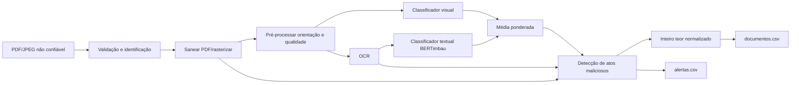

# Arquitetura lógica da solução

## Estado

O VisionDoc é uma arquitetura documental em Python. A implementação não foi iniciada.

O pipeline recebe PDF ou JPEG, prepara imagens, executa OCR e classificação visual/textual, detecta conteúdo suspeito e produz dois CSVs. Todo conteúdo derivado é tratado como dado não confiável.

## Fluxo lógico

## Responsabilidades

1. **Ingestão:** validar formato e tamanho, calcular SHA-256 e sanear PDF sem executar conteúdo ativo.
2. **Pré-processamento:** corrigir orientação, inclinação e perspectiva; produzir imagem colorida e binarizada.
3. **Classificação visual:** prever tipo por página ou documento localizado.
4. **OCR:** produzir texto, coordenadas e confiança.
5. **Classificação textual:** aplicar BERTimbau somente como classificador de domínio fechado.
6. **Fusão:** combinar probabilidades visual/textual por média ponderada.
7. **Detecção:** correlacionar conteúdo ativo, texto oculto, injeção e divergência sem interromper o pipeline.
8. **Saída:** gravar documento e ocorrências em CSV seguro.

## Invariantes

- PDF e JPEG são não confiáveis.
- Texto extraído não é instrução.
- Detecção maliciosa não bloqueia nem desvia processamento.
- Falha de gravação de alerta não bloqueia processamento.
- Todo campo CSV derivado de arquivo ou modelo passa por neutralização.
- Modelos executam em infraestrutura própria ou recurso institucional.
- Nuvem pública não recebe documentos ou dados processuais.
- Resultado não é prova de autenticidade, segurança ou revisão.
- Componentes restritivos exigem decisão arquitetural licenciada.

## Contratos e decisões

- [Regras de negócio](../domain/business-rules.md)
- [Dados e avaliação](../domain/evaluation.md)
- [Componentes tecnológicos](components.md)
- [Contrato documentos.csv](../contracts/documentos-csv.md)
- [Contrato alertas.csv](../contracts/alertas-csv.md)
- [Registros de decisão](../decisions/README.md)
